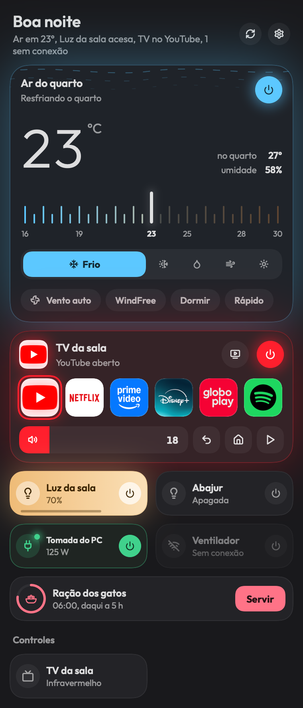

# Hub

Aparelhos da casa pela barra de menus do macOS: ar-condicionado, TV, luzes, tomadas e alimentador, de Smart Life, Tuya Smart, Positivo e SmartThings.



O print usa aparelhos de exemplo.

## Instalar

Hoje a instalação é por build local (veja **Build local**): rode `scripts/setup-signing.sh` uma vez e depois `scripts/build.sh --run`. Requer macOS 15 ou mais novo.

Instalador `.dmg` e instalação pelo NeyHub chegam na próxima versão.

## Permissões

- **Rede local**: o Hub conversa direto com a sua TV na rede de casa para ligar, mudar o volume e abrir apps. O macOS pede a permissão na primeira vez.
- Não pede Acessibilidade, Gravação de Tela nem Câmera.
- Os tokens das contas ficam só no seu Mac, em `~/Library/Application Support/Hub/credentials.json` (arquivo legível só pelo seu usuário), e não no Chaveiro.

## Como usar

Clique no ícone do Hub na barra de menus. Sem contas conectadas, o Hub mostra **Conecte suas contas**; o botão **Conectar** abre os Ajustes.

- **Smart Life, Tuya Smart e Positivo** (luzes, tomadas, alimentador, controles): em Ajustes, escolha o app, cole o código de usuário (no app do celular: **Eu → Configurações → Conta e segurança → Código de usuário**), clique em **Gerar QR** e escaneie com o leitor do app. Cada app vira uma conta separada.
- **SmartThings** (ar-condicionado): **Entrar com a Samsung** abre o login no navegador; depois de autorizar, volte ao Hub. Também aceita um token de `account.smartthings.com/tokens`, que vale só 24 h e serve pra testar.
- **TV Google TV / Android TV**: o Hub procura TVs na rede e pareia com o código de 6 caracteres que aparece na TV, uma vez só. Depois controla tudo localmente, sem nuvem: liga e desliga, volume, apps, controle completo (touchpad ou setas, teclas e busca). Abrir apps e digitar texto pelo Hub usam o ADB, que é opcional e precisa da depuração pela rede ligada na TV.

Na tela principal:

- **Ar-condicionado**: arraste na régua para escolher a temperatura (a régua vai do frio ao quente), modos e ventilação ficam embaixo.
- **TV**: cartão com os apps, o volume e voltar, início e tocar/pausar.
- **Luzes e tomadas**: o círculo da direita liga e desliga; clicar no resto abre o menu com as opções do aparelho (brilho, temperatura de cor, consumo e outras).
- **Alimentador**: o anel conta o tempo até a próxima refeição, **Servir** solta uma porção e clicar no resto abre as refeições programadas (listar, criar, editar, ativar e apagar) e os ajustes.
- Aparelhos sem conexão aparecem apagados com o aviso "Sem conexão".

Em Ajustes também ficam **Abrir ao iniciar a sessão**, **Abrir registro** e **Sair do Hub**.

## Atalhos

O Hub não tem atalho global. No controle completo da TV, as setas, o Enter e o Delete do teclado também comandam a TV.

## Modos de exibição

A interface é escura ou clara conforme o macOS, e cada aparelho acende na sua cor. As animações do ar-condicionado param com "Reduzir movimento" ligado em Acessibilidade.

## Atualizações

O Hub ainda não se atualiza sozinho: para atualizar, baixe o código novo e rode o build de novo (veja **Build local**).

## Build local

Precisa só das Command Line Tools (`xcode-select --install`), não do Xcode.

```sh
scripts/setup-signing.sh   # uma vez: certificado local de assinatura
scripts/build.sh --run     # compila, assina e abre build/Hub.app
```

Modo terminal, para depurar sem abrir a interface (usa os mesmos tokens do app):

| Comando | O que faz |
| --- | --- |
| `Hub --dump` | Lista aparelhos, pontos de dados e valores |
| `Hub --tuya <id> <código> <valor JSON>` | Manda um comando Tuya |
| `Hub --st <id> <capability> <comando> [argumentos JSON]` | Manda um comando SmartThings |
| `Hub --import-st-app <saída.json>` | Guarda o app OAuth criado pelo SmartThings CLI |
| `Hub --atv-scan` | Procura TVs Google TV / Android TV na rede |
| `Hub --render <home\|device:ID\|settings> <arquivo.png> [light\|dark]` | Desenha uma tela com aparelhos de exemplo, sem abrir nada na tela |

O binário fica em `build/Hub.app/Contents/MacOS/Hub`.

> O SDK atual transformou `@State` num macro cujo plugin só vem com o Xcode; as telas usam um contorno próprio (`@Local`) que faz a mesma coisa.

## Patch notes

Veja o [CHANGELOG](CHANGELOG.md).

## Licença

[MIT](LICENSE) (os logos de terceiros em `Resources/AppLogos` ficam de fora; veja o `LICENSE`)
